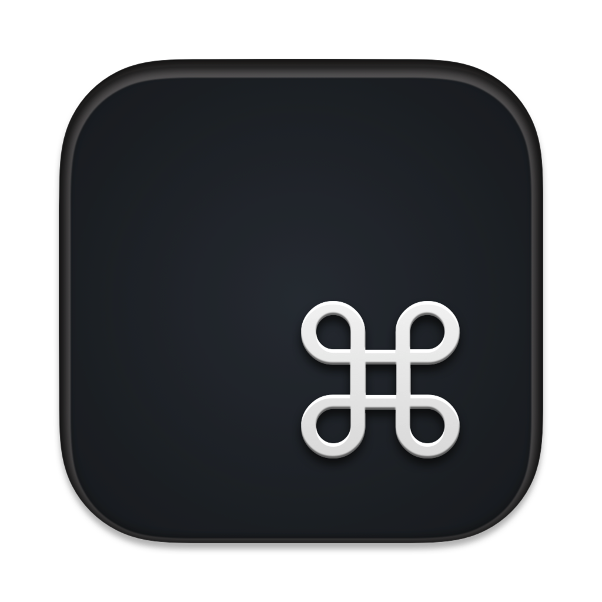
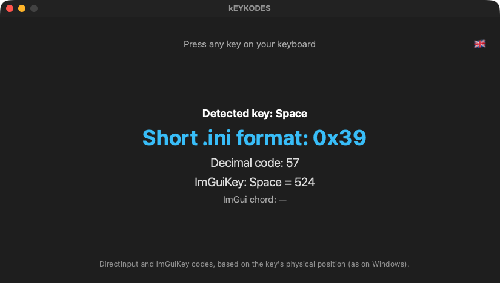

<p align="center"></p>

# kEYKODES

**Shows the DirectInput and ImGui key codes to put in Skyrim .ini files and mod menus.**  
*Affiche les codes de touches DirectInput et ImGui à mettre dans les .ini de Skyrim et les menus de mods.*

🍏 **Native Mac app written in Swift, signed and notarized by Apple.** · *Appli Mac native écrite en Swift, signée et notarisée par Apple.*

🇬🇧 [English](#-english) · 🇫🇷 [Français](#-français)

💬 **Support & community:** [Discord](https://discord.gg/xdDVDPQsYs) · *Aide et communauté : [Discord](https://discord.gg/xdDVDPQsYs)*

### About

kEYKODES shows the DirectInput and ImGui key codes to put in Skyrim .ini files and mod menus. By Starbudweiser & Claude Code (Anthropic). MIT License, © 2026 Starbudweiser. Provided as is, without warranty of any kind. See **About kEYKODES** in the app menu.

---
## 🇬🇧 English

### What it does

Many mods ask for key codes in their .ini files (DirectInput scancodes) or ImGui menus. On a Mac keyboard, finding them is guesswork. Press a key in kEYKODES and it shows the code Skyrim expects, based on the key's physical position — exactly as under Windows.

### Features

- Short .ini format (`0x39`) and decimal code (`57`) of the pressed key.
- ImGuiKey value and modifier chords (Ctrl, Shift, Alt…) for mod menus.
- AZERTY, QWERTZ, ISO and ANSI keyboards: the code follows the physical position.
- Mouse buttons and wheel supported.
- Interface in **English, French, Italian and Spanish** (follows your Mac's language; can be changed in the app).

### What's new in 1.3.0

- Signed with a Developer ID and notarized by Apple: macOS now opens the app without a security warning.
- Rewritten as a native Swift app (no more Python/PyInstaller bundle, which antivirus scanners tend to flag). Same keys, same codes, same look.
- The first letter of the app's name now uses the colour of its logo everywhere it appears.
- Version number aligned across the Skyrim Mac Toolkit.

### Updates

The app checks once a day whether a newer release exists on GitHub and offers to open the Nexus page, remind you later or skip that version. Nothing is downloaded or installed automatically. The full history is in [CHANGELOG.md](CHANGELOG.md).

### Screenshots


*Space bar: 0x39, decimal 57, ImGuiKey 524*

### Requirements

A Mac with **Apple Silicon** (M1 or later), **macOS 15 Sequoia** or later. Native Mac app written in Swift and notarized by Apple: no Python, no Wine, no virtual machine needed.

### Installation

1. Download the zip from Nexus Mods (or from the GitHub releases) and unzip it.
2. Move **kEYKODES.app** to your **Applications** folder.

### How to use

1. Open kEYKODES and press the key you want.
2. Copy the code into the mod's .ini file or menu.

### Building from source

Requires Xcode (Swift 6). From the repository folder:

```bash
./build_app.sh
```

### License

Released under the **MIT License**: free to use, modify and share. Part of the **Skyrim Mac Toolkit**, a set of modding tools built for Skyrim players on Mac.

---

## 🇫🇷 Français

### À quoi ça sert

Beaucoup de mods demandent des codes de touches dans leurs .ini (scancodes DirectInput) ou leurs menus ImGui. Sur un clavier Mac, il faut deviner. Appuyez sur une touche dans kEYKODES : il affiche le code attendu par Skyrim, selon la position physique de la touche — exactement comme sous Windows.

### Fonctions

- Format .ini court (`0x39`) et code décimal (`57`) de la touche pressée.
- Valeur ImGuiKey et combinaisons avec modificateurs (Ctrl, Maj, Alt…) pour les menus de mods.
- Claviers AZERTY, QWERTZ, ISO et ANSI : le code suit la position physique.
- Boutons et molette de la souris pris en charge.
- Interface en **français, anglais, italien et espagnol** (suit la langue du Mac ; modifiable dans l'appli).

### Nouveautés de la 1.3.0

- Signée avec un certificat Developer ID et notarisée par Apple : macOS ouvre désormais l'appli sans avertissement de sécurité.
- Réécrite en Swift natif (plus de paquet Python/PyInstaller, souvent signalé par les antivirus). Mêmes touches, mêmes codes, même aspect.
- La première lettre du nom de l'appli prend la couleur de son logo partout où il est écrit.
- Numéro de version commun à tout le Skyrim Mac Toolkit.

### Mises à jour

L'appli vérifie une fois par jour si une version plus récente existe sur GitHub et propose d'ouvrir la page Nexus, de rappeler plus tard ou d'ignorer cette version. Rien n'est téléchargé ni installé automatiquement. L'historique complet est dans [CHANGELOG.md](CHANGELOG.md).

### Captures d'écran


*Barre d'espace : 0x39, décimal 57, ImGuiKey 524*

### Configuration requise

Un Mac **Apple Silicon** (M1 ou plus récent), **macOS 15 Sequoia** ou plus récent. Appli Mac native écrite en Swift et notarisée par Apple : ni Python, ni Wine, ni machine virtuelle.

### Installation

1. Téléchargez le zip sur Nexus Mods (ou dans les releases GitHub) et décompressez-le.
2. Placez **kEYKODES.app** dans votre dossier **Applications**.

### Utilisation

1. Ouvrez kEYKODES et appuyez sur la touche voulue.
2. Recopiez le code dans le .ini ou le menu du mod.

### Compiler depuis les sources

Nécessite Xcode (Swift 6). Depuis le dossier du dépôt :

```bash
./build_app.sh
```

### Licence

Publié sous **licence MIT** : libre d'utilisation, de modification et de partage. Fait partie du **Skyrim Mac Toolkit**, un ensemble d'outils de modding pensés pour les joueurs de Skyrim sur Mac.
