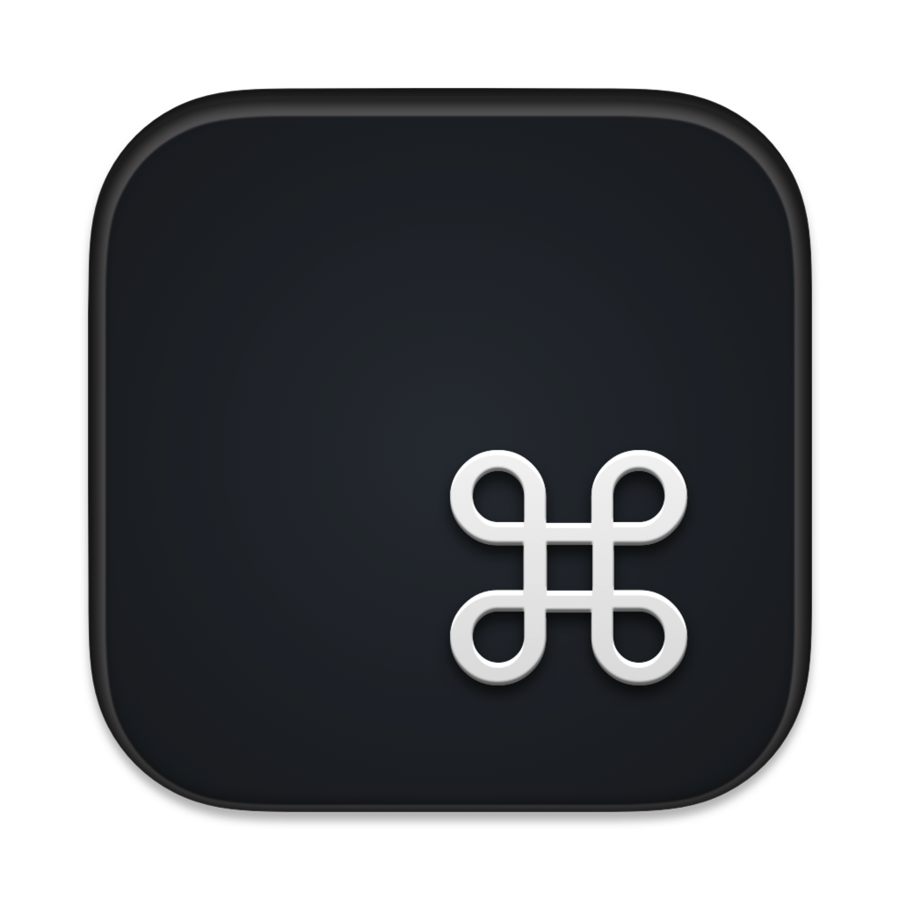
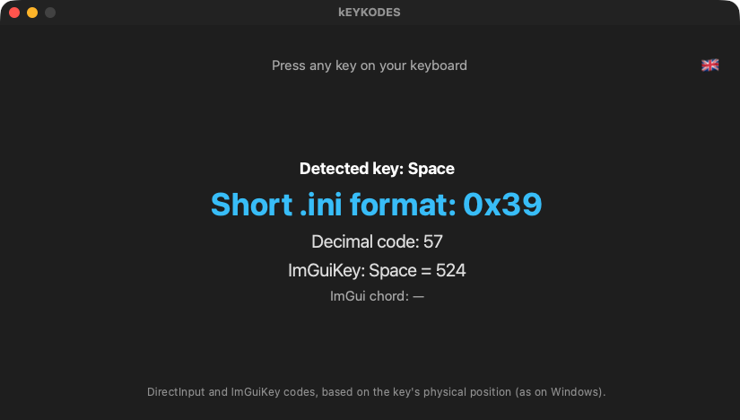

<p align="center"></p>

# kEYKODES

**Shows the DirectInput and ImGui key codes to put in Skyrim .ini files and mod menus.**  
*Affiche les codes de touches DirectInput et ImGui à mettre dans les .ini de Skyrim et les menus de mods.*

🇬🇧 [English](#-english) · 🇫🇷 [Français](#-français)

---
## 🇬🇧 English

### What it does

Many mods ask for key codes in their .ini files (DirectInput scancodes) or ImGui menus. On a Mac keyboard, finding them is guesswork. Press a key in kEYKODES and it shows the code Skyrim expects, based on the key's physical position — exactly as under Windows.

### Features

- Short .ini format (`0x39`) and decimal code (`57`) of the pressed key.
- ImGuiKey value and modifier chords (Ctrl, Shift, Alt…) for mod menus.
- AZERTY, QWERTZ, ISO and ANSI keyboards: the code follows the physical position.
- Mouse buttons and wheel supported.
- Interface in **English, French, Italian and Spanish** (follows your Mac's language; can be changed in the app).

### Screenshots


*Space bar: 0x39, decimal 57, ImGuiKey 524*

### Requirements

A Mac with **Apple Silicon** (M1 or later), **macOS 13 Ventura** or later. No Python, no Wine, no virtual machine needed.

### Installation

1. Download the zip from Nexus Mods (or from the GitHub releases) and unzip it.
2. Move **kEYKODES.app** to your **Applications** folder.
3. First launch: the app is signed with a personal certificate but **not notarized by Apple**, so macOS blocks it. Open **System Settings → Privacy & Security**, scroll down and click **Open Anyway** next to kEYKODES, then confirm. On macOS 14 or earlier you can also right-click the app → **Open** → **Open**.
4. Still blocked? In Terminal: `xattr -dr com.apple.quarantine /Applications/kEYKODES.app`

### How to use

1. Open kEYKODES and press the key you want.
2. Copy the code into the mod's .ini file or menu.

### Building from source

Requires Python 3.12 with PyQt6 and PyInstaller. From the repository folder:

```bash
./build_app.sh
```

### License

Released under the **MIT License**: free to use, modify and share. Part of the **Skyrim Mac Toolkit**, a set of modding tools built for Skyrim players on Mac.

---

## 🇫🇷 Français

### À quoi ça sert

Beaucoup de mods demandent des codes de touches dans leurs .ini (scancodes DirectInput) ou leurs menus ImGui. Sur un clavier Mac, il faut deviner. Appuyez sur une touche dans kEYKODES : il affiche le code attendu par Skyrim, selon la position physique de la touche — exactement comme sous Windows.

### Fonctions

- Format .ini court (`0x39`) et code décimal (`57`) de la touche pressée.
- Valeur ImGuiKey et combinaisons avec modificateurs (Ctrl, Maj, Alt…) pour les menus de mods.
- Claviers AZERTY, QWERTZ, ISO et ANSI : le code suit la position physique.
- Boutons et molette de la souris pris en charge.
- Interface en **français, anglais, italien et espagnol** (suit la langue du Mac ; modifiable dans l'appli).

### Captures d'écran


*Barre d'espace : 0x39, décimal 57, ImGuiKey 524*

### Configuration requise

Un Mac **Apple Silicon** (M1 ou plus récent), **macOS 13 Ventura** ou plus récent. Ni Python, ni Wine, ni machine virtuelle.

### Installation

1. Téléchargez le zip sur Nexus Mods (ou dans les releases GitHub) et décompressez-le.
2. Placez **kEYKODES.app** dans votre dossier **Applications**.
3. Premier lancement : l'appli est signée avec un certificat personnel mais **pas notarisée par Apple**, macOS la bloque donc. Ouvrez **Réglages Système → Confidentialité et sécurité**, descendez et cliquez sur **Ouvrir quand même** à côté de kEYKODES, puis confirmez. Sous macOS 14 ou antérieur, vous pouvez aussi faire clic droit sur l'appli → **Ouvrir** → **Ouvrir**.
4. Toujours bloquée ? Dans le Terminal : `xattr -dr com.apple.quarantine /Applications/kEYKODES.app`

### Utilisation

1. Ouvrez kEYKODES et appuyez sur la touche voulue.
2. Recopiez le code dans le .ini ou le menu du mod.

### Compiler depuis les sources

Nécessite Python 3.12 avec PyQt6 et PyInstaller. Depuis le dossier du dépôt :

```bash
./build_app.sh
```

### Licence

Publié sous **licence MIT** : libre d'utilisation, de modification et de partage. Fait partie du **Skyrim Mac Toolkit**, un ensemble d'outils de modding pensés pour les joueurs de Skyrim sur Mac.
